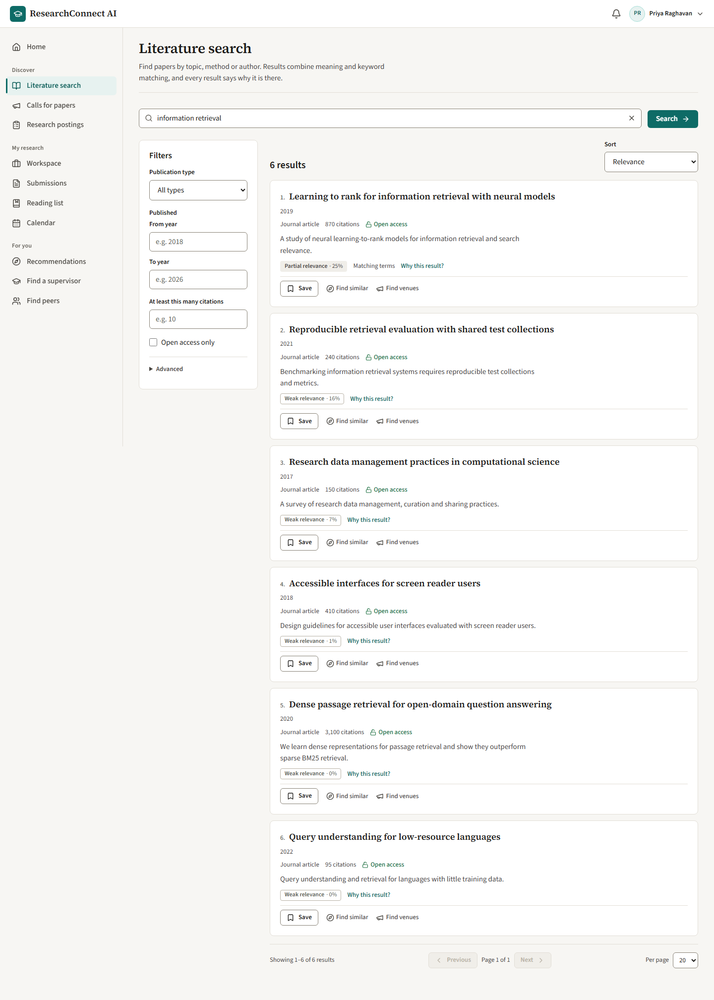
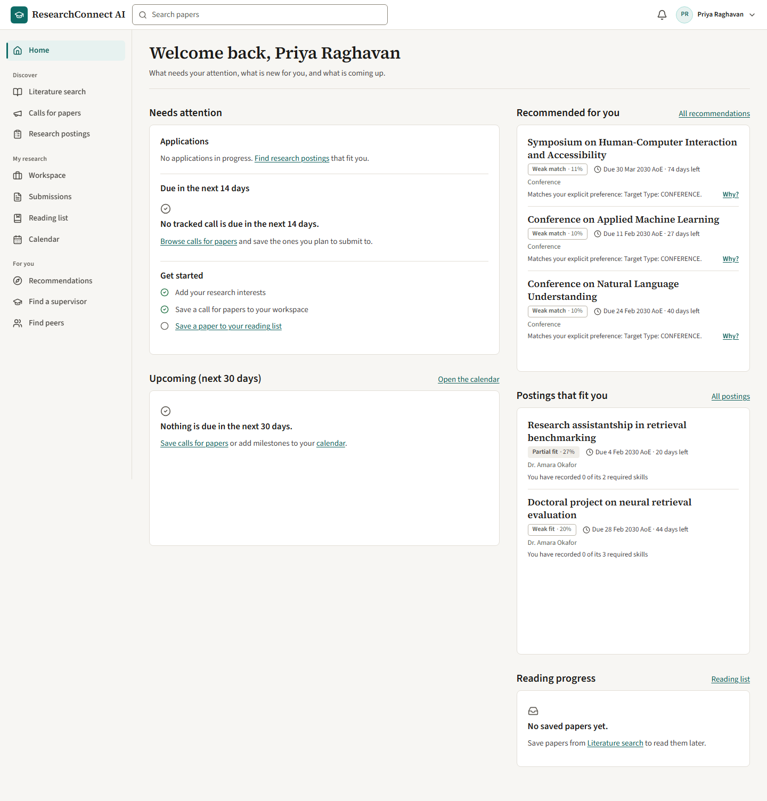
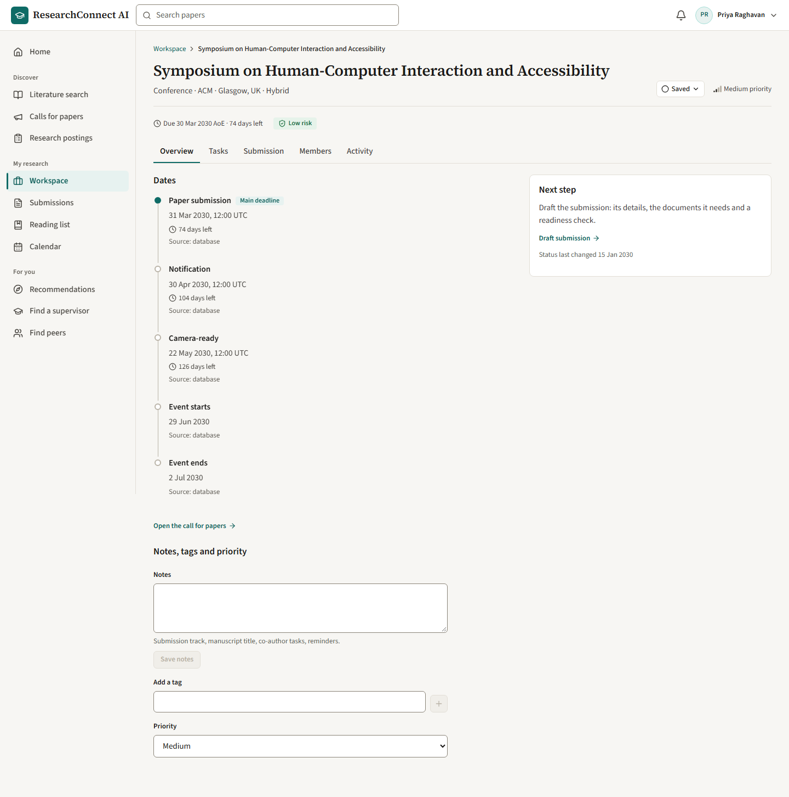
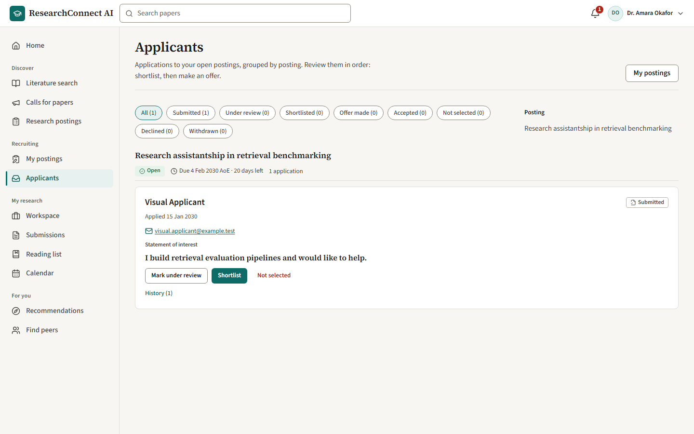
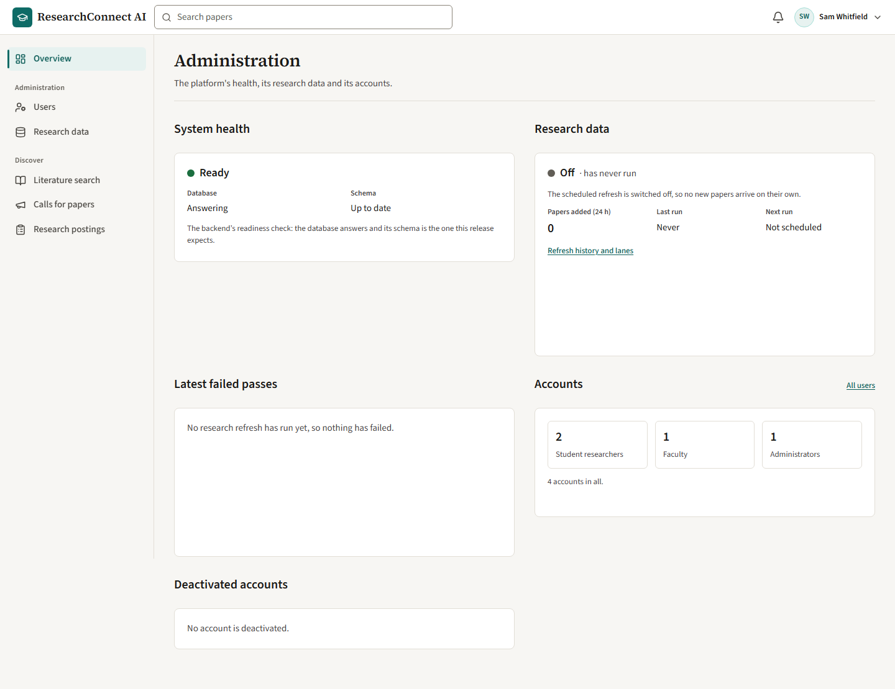
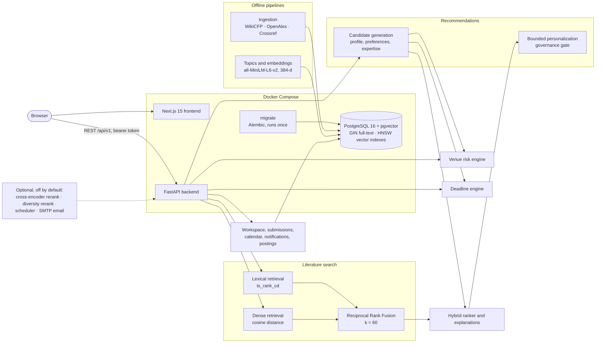

<div align="center">

# ResearchConnect AI

**Explainable academic opportunity discovery and venue risk assessment for students and early-career researchers.**

Find calls for papers and scholarly literature, see the evidence behind a venue before you submit, read every
deadline in your own time zone, and keep your research work in one place.

[](https://github.com/FuricBond/Research-Connect-AI/actions/workflows/ci.yml)
[](LICENSE)


[Getting started](#getting-started) · [Architecture](#system-architecture) · [How it works](#how-it-works) ·
[Testing](#testing-and-quality-assurance) · [Known limitations](#known-limitations)

</div>

<p align="center">
  
  <br>
  <sub>Literature search on the demonstration data. Every result says how relevant it is and why it is there.</sub>
</p>

## Table of contents

- [Overview](#overview)
- [The problems it addresses](#the-problems-it-addresses)
- [Key features](#key-features)
- [Screenshots](#screenshots)
- [System architecture](#system-architecture)
- [Technology stack](#technology-stack)
- [How it works](#how-it-works)
- [User workflows](#user-workflows)
- [Repository structure](#repository-structure)
- [Getting started](#getting-started)
- [Local development](#local-development)
- [Database and migrations](#database-and-migrations)
- [Configuration](#configuration)
- [Testing and quality assurance](#testing-and-quality-assurance)
- [Security and permissions](#security-and-permissions)
- [Documentation](#documentation)
- [Known limitations](#known-limitations)
- [Project status and roadmap](#project-status-and-roadmap)
- [Troubleshooting](#troubleshooting)
- [Contributing](#contributing)
- [License and acknowledgments](#license-and-acknowledgments)

## Overview

ResearchConnect AI is a web platform for the part of research that happens before and around writing: deciding
where to submit, finding related work, judging whether a venue can be trusted, keeping track of deadlines, and
managing applications and submissions. It is built for students and early-career researchers, and for the faculty
who recruit them.

It brings together what is usually spread across aggregators, publisher pages, spreadsheets and calendars:

- **Calls for papers** collected from WikiCFP, searchable and filterable.
- **Scholarly literature** from OpenAlex and Crossref, searched by meaning as well as keywords.
- **Venue risk** assessed from published evidence, with an explicit answer when there is not enough of it.
- **Deadlines** normalized to UTC, with Anywhere-on-Earth semantics for academic submissions.
- **Workflow**: a workspace for saved calls, submission tracking, a calendar with iCal export, reminders and
  shared workspaces.
- **Recruiting**: verified faculty publish research postings and openings, and students apply.

Ranking, risk and deadline decisions are deterministic and explained. The same inputs give the same results, and
each score can be traced to the signals that produced it.

## The problems it addresses

| Problem | What ResearchConnect AI does |
|---|---|
| Calls for papers and openings are scattered across many sites | Ingests calls from WikiCFP and papers from OpenAlex and Crossref into one database, de-duplicated and change-tracked |
| Keyword search misses related work described in other words | Literature search fuses PostgreSQL full-text search with pgvector embedding similarity |
| A venue's credibility is hard to judge from one signal | A rule-based engine weighs positive and negative evidence, and reports *insufficient evidence* rather than defaulting to "safe" |
| Deadlines appear in local time, UTC, AoE or with no time zone at all | Deadlines are normalized to UTC; unknown or ambiguous input is flagged, never guessed |
| Saved calls, submissions and dates end up in separate tools | A workspace, submission tracker, calendar and notification centre share one canonical deadline and risk record |

## Key features

### Academic opportunity discovery
Browse calls for papers with text search and filters for type, attendance (online, in person, hybrid), sort order
and upcoming deadlines. A call's page shows its dates, venue risk and evidence, and can be saved to the workspace
or added to the calendar. **Find venues** goes the other way: start from a paper and find calls that match it.

### Hybrid literature search
Search the paper corpus by topic, method or author. Two retrieval channels run for each query, lexical full-text
search and dense vector search, and their ranked lists are combined with Reciprocal Rank Fusion. Results can be
filtered by type, year, citations and open access, and **Find similar** retrieves papers close to a chosen one.

### Explainable ranking
Each search result carries a relevance label and a **Why this result?** panel with the signals behind its score,
the score breakdown and its limitations. Recommendations have a **Why this match?** explanation of the same kind.

### Personalized recommendations
Recommendations are a separate path from search. Candidate calls are generated from the researcher's profile,
explicit preferences, inferred interests and expertise; they are scored by the same hybrid ranker, then adjusted by
a bounded personalization term that is supervised by a governance gate and can be paused or reset by the
researcher.

### Venue risk assessment
Risk is assessed from weighted evidence (payment and review claims, publisher and editorial signals, domain and
contact patterns, indexing such as DOAJ) into **low risk**, **moderate risk**, **high risk** or **insufficient
evidence**. The explanation lists the evidence on both sides, and states that missing information is not a sign of
predatory behaviour.

### Deadline intelligence
Seven milestone types (submission, abstract, notification, camera-ready, registration, event start and end) are
extracted and normalized to UTC. Explicit time zones, IANA zone names, numeric and written UTC/GMT offsets and AoE
are handled; date-only submission deadlines are read as 23:59:59 AoE and marked as inferred. Conflicting sources and
revisions are resolved by source authority and recorded.

### Research workspace
Follow each saved call from *saved* through *considering*, *planning*, *applied*, *accepted* or *rejected*, to
*archived*. Track submissions with versioned document records and a readiness check, see every milestone on a
research calendar with iCal export, and get deadline reminders in the notification centre (and by email when SMTP
is configured). Shared workspaces add owner, editor, contributor and viewer roles, invitations, tasks and an
activity feed. A reading list keeps saved papers with notes and exports them as BibTeX.

### Faculty recruiting
Faculty publish research postings: projects, thesis topics, collaborations, lab rotations, and openings
(internships, research assistantships and post-doctoral positions) that accept applications on the platform. Only
**verified faculty** can publish or receive applications; an administrator grants the verification. Faculty review
applicants in an inbox and move each application through shortlisting to a decision. Students see a fit score for
each posting, and can find supervisors and peers who opted in to discovery.

### Administration
Administrators see platform health, manage accounts (role, activation, faculty verification) and monitor research
data ingestion. They administer the platform only: personal research workflows (reading list, workspace,
submissions, calendar, researcher profile, applying) and recruiting are refused to them by the API itself.

## Screenshots

All screenshots are the visual-regression baselines rendered from the made-up demonstration data; no real people
appear in them.

<table>
  <tr>
    <td width="50%"><br><sub>Student home</sub></td>
    <td width="50%"><br><sub>A saved call in the workspace</sub></td>
  </tr>
  <tr>
    <td width="50%"><br><sub>Faculty applicant inbox</sub></td>
    <td width="50%"><br><sub>Administration overview</sub></td>
  </tr>
</table>

The interface follows its own design system ("Scholarly Ledger": paper-white surfaces, petrol teal accents, Source
Serif 4 and Source Sans 3), with light and dark themes; see [DESIGN_SYSTEM.md](docs/design/DESIGN_SYSTEM.md).

## System architecture



The browser loads pages from the Next.js server and calls the REST API directly with a signed bearer token. The
backend is a modular monolith on one PostgreSQL database.

- **Literature search** retrieves candidates lexically and by vector similarity, fuses them with RRF, ranks them
  with the hybrid ranker and explains each result.
- **Recommendations** are a separate path: they generate candidates from the researcher's profile, score them with
  the same hybrid ranker, assess risk and deadlines for each, and add the bounded personalization term.
- Risk and deadline results are canonical: the workspace, calendar and recommendations use them rather than
  recomputing them.
- Ingestion, topic tagging and embedding run offline or on the optional scheduler, never inside a request.

| Backend module | Responsibility |
|---|---|
| `app/api` | Versioned REST endpoints, the shared identity dependency, role checks |
| `app/search`, `app/repositories` | Query intelligence, lexical and vector retrieval, rank fusion |
| `app/ranking` | Hybrid ranker, explanations, optional diversity and cross-encoder reranking, risk engine, deadline engine |
| `app/personalization` | Preference interpretation, scoring, adaptive signals, calibration, governance, transparency |
| `app/services` | Researchers, workspaces, submissions, calendar, notifications, postings, email confirmation |
| `app/scheduler` | Optional jobs: deadline expiry, reminders, email delivery, signal and governance refresh, ingestion |

## Technology stack

| Layer | Technology | Purpose |
|---|---|---|
| Frontend | Next.js 15.5 (App Router), React 19, TypeScript, CSS Modules with design tokens, Tailwind CSS | User interface |
| Backend | Python 3.13, FastAPI 0.115, Pydantic 2, SQLAlchemy 2.0 | API and domain logic |
| Database | PostgreSQL 16 with pgvector 0.8 (`pgvector/pgvector:0.8.6-pg16`), Alembic migrations | Persistence, full-text and vector indexes |
| Retrieval | PostgreSQL `websearch_to_tsquery` and `ts_rank_cd` over GIN indexes; pgvector cosine distance over HNSW indexes | Lexical and dense retrieval |
| Embeddings | sentence-transformers 3.3, `all-MiniLM-L6-v2` (384 dimensions) | Semantic representations, generated offline |
| Ingestion | requests, Beautiful Soup (WikiCFP); OpenAlex and Crossref REST APIs | Academic metadata |
| Authentication | PyJWT (HS256 bearer tokens), bcrypt | Sign-in and token revocation |
| Testing | pytest, Vitest, Playwright, axe-core | Unit, integration, browser, accessibility and visual tests |
| Delivery | Docker Compose with hardened non-root images; GitHub Actions | Local and production-style runs; CI |

## How it works

These are the methods as implemented on the serving paths. The accompanying research paper and the
[methodology](docs/METHODOLOGY.md) give the full mathematical treatment.

**Lexical retrieval.** Titles, abstracts and metadata are indexed as weighted `tsvector` columns (title 1.0, body
0.4, metadata 0.2). Queries are parsed with `websearch_to_tsquery`, academic acronyms such as *NLP* are expanded
first, and matches are scored with `ts_rank_cd`.

**Dense retrieval.** Titles and abstracts are embedded offline with `all-MiniLM-L6-v2`. A query is embedded at
request time and compared by cosine distance through an HNSW index. If embeddings are missing, search falls back to
lexical ranking.

**Reciprocal Rank Fusion.** Each channel is over-sampled 2.5× and the two ranked lists are combined by
RRF(d) = Σ 1 / (60 + rank), so scores from different scales need no calibration.

**Hybrid ranking.** Fused candidates are scored by a weighted sum of normalized signals: relevance (semantic,
lexical, topic), context (type, freshness, urgency, venue quality) and academic signals (citations, authors,
institution, venue, open access). Ties are broken deterministically, ending with the item's identifier. Two of
the three presets keep at least 85% of the weight on relevance; the research-opportunity preset used for
recommendations keeps 75%.

**Explanations.** Because the score is additive, each signal's contribution is exact, and the explanation
reconciles to the final score. Signals that carry no weight in a mode are reported as inactive rather than hidden.

**Venue risk.** Each evidence item contributes its base weight times strength and confidence multipliers.
Correlated items within a group decay and are capped, so one irregularity cannot count many times, and positive
evidence can offset at most 65% of the negative score. High risk requires both a high score and enough confidence;
when little is known, the result is *insufficient evidence*. Thirteen safety rules guard against common false
positives: a large publisher, a shared hosting platform, an article processing charge or few citations is not
evidence of risk on its own.

**Deadline normalization.** AoE is the fixed offset UTC−12:00. IANA zones are resolved with their daylight-saving
offsets for the date in question. An unrecognized zone or an offset outside UTC−12:00 to UTC+14:00 is marked
*invalid*, and a day/month order that cannot be told apart (`04/05/2026`) is marked *ambiguous*; neither is turned
into a UTC instant. Urgency rises linearly over a 90-day window, with tiers at 3, 14 and 30 days.

**Governed personalization.** The personalization term is at most 0.15, damped for weakly relevant candidates, and
zero for high-risk, predatory or expired opportunities. A governance gate compares recent behaviour with history
and scales adaptive signals by 1, 0.5, 0.25, 0.1 or 0 (suspended).

**Optional components.** Diversity re-ranking and the cross-encoder reranker exist and are tested, but are not used
by default: diversity runs only when an API request asks for it, and the interface never does; the cross-encoder
runs only when the server's `RERANKER_ENABLED` setting is on, never because a request asks.

## User workflows

**Student or researcher**
1. Register, sign in and confirm the email address from the link sent to it.
2. Browse calls for papers, or search the literature and use **Find venues** from a paper.
3. Open a call to read its venue risk evidence and its dates in UTC.
4. Save it to the workspace and move it along as plans change; add its dates to the calendar.
5. Track the submission and its documents, and get reminders before each deadline.
6. Apply to research openings, follow each application, and find supervisors and peers.

**Faculty**
1. Register as faculty; an administrator verifies the account before recruiting is possible.
2. Write a posting, save it as a draft and publish it.
3. Review applicants in the inbox: shortlist, make an offer or decline, with a message.

**Administrator**
1. Check platform health and account counts on the overview.
2. Find accounts by name, email, role or status; change a role, deactivate or reactivate, and verify faculty.
3. Monitor research data ingestion runs and their freshness.

## Repository structure

```text
Research-Connect-AI/
├── backend/            FastAPI application
│   ├── app/            API, search, ranking, personalization, services, scheduler, models
│   ├── alembic/        Database migrations
│   ├── scripts/        Demo and community seeders, database wait helper
│   └── tests/          pytest suite
├── frontend/           Next.js application
│   ├── app/            Routes (App Router)
│   ├── components/     Interface, by feature
│   ├── tests/          Vitest suite
│   └── e2e/            Playwright suites and visual baselines
├── scrapers/           WikiCFP, OpenAlex and Crossref ingestion, with its own tests
├── ml/                 Topic taxonomy and analysis, embedding generation
├── e2e/                End-to-end harness: isolated stack, API and stack suites
├── demo/               Isolated demonstration stack
├── docs/               Architecture, design, database, methodology and evaluation documents
├── artifacts/          Recorded evaluation results
├── .github/workflows/  CI
└── docker-compose.yml  PostgreSQL, migrations, backend and frontend
```

## Getting started

### Prerequisites

| To | You need |
|---|---|
| Run the whole stack | Git, Docker with Docker Compose |
| Develop on the host | Python 3.13 and Node.js 24 (the versions CI and the images use), plus Docker for the database |

### 1. Clone and configure

```bash
git clone https://github.com/FuricBond/Research-Connect-AI.git
```
```bash
cd Research-Connect-AI
```
```bash
cp .env.example .env
```

Set the two required values in `.env`: `POSTGRES_PASSWORD` and `AUTH_SECRET_KEY`. Generate each with:

```bash
python -c "import secrets; print(secrets.token_urlsafe(48))"
```

Never commit `.env`; it is git-ignored.

### 2. Start the stack

```bash
docker compose up --build -d --wait
```

The first build takes several minutes. Migrations run automatically before the API starts, and the API reports
ready only when the database schema matches the code.

| Service | Address |
|---|---|
| Web application | http://localhost:3000 |
| REST API | http://localhost:8000 |
| PostgreSQL | `127.0.0.1:5432` |

Every port is published on localhost only. Check readiness with:

```bash
curl http://localhost:8000/api/health/ready
```

### 3. Load demonstration data (optional)

```bash
docker compose exec backend python -m scripts.seed_demo_data --password '<choose a password>'
```

This creates three accounts, `demo.student@researchconnect.test`, `demo.faculty@researchconnect.test` and
`demo.admin@researchconnect.test`, all with the password you chose, plus twelve made-up calls for papers,
preferences and research postings. The stack runs in production mode, so a password of your own is required.

To make the platform look in use, add a community of sixty fictional researchers, and load real calls for papers
from WikiCFP (this needs network access):

```bash
docker compose exec backend python -m scripts.seed_community --password '<choose a password>'
```
```bash
docker compose exec backend python -m scrapers.pipelines.collect_opportunities --topic "machine learning" --pages 2
```

The demo seed adds no research papers, so literature search starts empty; see
[Loading research papers](#loading-research-papers).

### A separate demonstration stack

`demo/` runs a second, isolated stack (its own project, volume, ports 3400 and 8400, and a mail sink) built from
the working tree, so it can sit beside a development stack:

```bash
python demo/demo.py up
```

See [demo/README.md](demo/README.md) for accounts, email confirmation and its limits.

<details>
<summary><b>Everyday commands</b></summary>

| Task | Command |
|---|---|
| Status and health | `docker compose ps` |
| Apply new migrations | `docker compose run --rm migrate` |
| Logs | `docker compose logs backend` (or `frontend`, `postgres`, `migrate`) |
| Stop, keeping data | `docker compose down` |
| Rebuild after code changes | `docker compose up --build -d --wait` |
| Recreate the demo accounts | `docker compose exec backend python -m scripts.seed_demo_data --reset --password '<password>'` |
| Database shell | `docker compose exec postgres psql -U researchconnect -d researchconnect` |

`docker compose down -v` deletes the database volume and **all its data**. Use it only when that is what you want.

</details>

## Local development

Run PostgreSQL in Docker and the backend and frontend on the host, for fast reloads.

```bash
docker compose up -d postgres
```

**Backend**, from the repository root:

```bash
python -m venv .venv
```
```bash
source .venv/bin/activate
```

On Windows, activate with `.venv\Scripts\Activate.ps1` instead. Then:

```bash
pip install -r backend/requirements.txt
```
```bash
cp backend/.env.example backend/.env
```

Set the password in `DATABASE_URL` in `backend/.env` to your `POSTGRES_PASSWORD`. Then, from `backend/`:

```bash
alembic upgrade head
```
```bash
python -m scripts.seed_demo_data
```
```bash
uvicorn app.main:app --reload --port 8000
```

Outside production, the seeder uses the public demo password `DemoPass123!`, which production mode refuses.
Interactive API documentation is served at http://localhost:8000/docs in development.

`sentence-transformers` installs PyTorch. For a smaller CPU-only install, install it first:

```bash
pip install --index-url https://download.pytorch.org/whl/cpu torch
```

**Frontend:**

```bash
cd frontend
```
```bash
npm install
```
```bash
npm run dev
```

### Loading research papers

Literature search, similar papers and **Find venues** work on papers loaded from OpenAlex. From `backend/`, with
`PYTHONPATH=..`, this loads 10,000 highly cited AI papers with abstracts (about 220 MB, 50 of the 1,000 free daily
OpenAlex credits), then tags and embeds them:

```bash
python -m scrapers.pipelines.collect_openalex --subfield 1702 --has-abstract --from-year 2015 --sort cited_by_count:desc --pages 50 --per-page 200
```
```bash
python -m ml.topic_analysis.process_topics
```
```bash
python -m ml.embeddings.generate_embeddings --entity research_work
```

A stopped load prints a `--cursor` to continue from. To keep the corpus current, set `SCHEDULER_ENABLED=true` and
`SCHEDULER_RESEARCH_REFRESH_ENABLED=true`: every 8 hours the backend then fetches newly published and rising papers
in `RESEARCH_REFRESH_SUBFIELDS`, tags and embeds them. See [OpenAlex integration](docs/research-data/openalex.md).

## Database and migrations

PostgreSQL 16 with the pgvector extension holds everything: accounts, calls, papers, embeddings, workflow records
and audit trails. Migration 0001 installs pgvector itself. Search relies on GIN indexes over generated `tsvector`
columns and HNSW indexes over the embedding columns.

| Task | Command (from `backend/`) |
|---|---|
| Apply all migrations | `alembic upgrade head` |
| Show the current revision | `alembic current` |
| Compare the models with the migrated schema | `alembic check` |

In Compose, the `migrate` service applies migrations before the backend starts, and the backend refuses to start
in production if the schema is behind the code. `alembic check` is clean: the models declare every index the
database relies on, including the search indexes. Review anything `alembic revision --autogenerate` proposes
before using it. See [PostgreSQL and pgvector](docs/database/postgres-pgvector.md) for the schema, indexes and
backups, and [Database startup](docs/architecture/phase6-5-database-startup.md) for the startup gate.

## Configuration

Docker Compose reads the root `.env` ([template](.env.example)); a backend run on the host reads `backend/.env`
([template](backend/.env.example)). The main settings:

| Variable | Required | Purpose |
|---|---|---|
| `POSTGRES_PASSWORD` | Yes | Database password (letters, digits and `- _ . ~` only) |
| `AUTH_SECRET_KEY` | Yes | Token signing secret, at least 32 characters |
| `APP_ENV` | No (`production` in Compose) | `development`, `test` or `production`; production refuses insecure settings at startup |
| `CORS_ORIGINS` | No | Exact browser origins allowed to call the API |
| `NEXT_PUBLIC_API_URL` | No (`http://localhost:8000`) | API address as the browser sees it; fixed at frontend build time |
| `API_DOCS_ENABLED` | No | Serve `/docs` and `/openapi.json` (off in production by default) |
| `SCHEDULER_ENABLED` | No (`false`) | Run the background jobs, in one backend process only |
| `SCHEDULER_RESEARCH_REFRESH_ENABLED` | No (`false`) | Also fetch new OpenAlex papers on a schedule |
| `OPENALEX_EMAIL`, `OPENALEX_API_KEY` | No | OpenAlex contact address and optional key (a secret) |
| `EMAIL_PROVIDER` | No (`mock`) | `smtp` sends notifications and email-confirmation links; `mock` sends nothing |
| `SMTP_HOST`, `SMTP_PORT`, `SMTP_USERNAME`, `SMTP_PASSWORD`, `SMTP_SECURITY` | With `smtp` | Mail server; the password is a secret |
| `EMAIL_FROM_ADDRESS`, `EMAIL_RECIPIENT_ALLOWLIST` | With `smtp` | Sender, and the addresses or `@domains` that may receive mail (empty means nobody) |
| `APP_PUBLIC_URL` | No | Base of the links inside emails |
| `RERANKER_ENABLED` | No (`false`) | Run the optional cross-encoder on literature search |

Every setting, every production rule and a deployment checklist are in
[Production configuration](docs/architecture/phase6-4-production-configuration.md).

## Testing and quality assurance

| Suite | Command | Runs in CI |
|---|---|---|
| Backend unit, integration and security tests | `pytest` (from `backend/`) | Yes |
| Scraper and ingestion tests | `pytest ../scrapers/tests` (from `backend/`) | Yes |
| Migration tests on isolated databases | `RUN_POSTGRES_MIGRATION_TESTS=1 pytest` | No |
| Wall-clock performance budgets | `pytest -m perf` | No |
| Frontend type-check and lint | `npm run type-check`, `npm run lint` (from `frontend/`) | Yes |
| Frontend unit and component tests | `npm test` | Yes |
| Production build and bundle budget | `npm run build`, `npm run check:bundle` | Yes |
| End to end: API workflows, browser journeys with axe accessibility scans, scheduler and restarts | `python e2e/run_e2e.py` | No |
| Visual regression (zero tolerance) | `python e2e/run_e2e.py --suites visual` | No |

[CI](.github/workflows/ci.yml) runs on every push and pull request. The backend job migrates a fresh pgvector
database, then runs the backend and scraper tests; the frontend job runs type-check, lint, Vitest, the build and the
bundle budget.

The end-to-end harness builds the production images and runs them as a separate Compose project on its own ports
with a mail sink, so it never touches your stack; a full run takes about 45 minutes. Run the visual suite on its own,
on a fresh stack: its baselines are taken on Windows. Performance-budget tests time code against fixed millisecond
budgets and can fail on a busy machine, which is why the default run leaves them out. See
[e2e/README.md](e2e/README.md).

Screen-reader checks (NVDA, VoiceOver) need a person and have not been performed; the steps are in
[Manual verification](docs/design/MANUAL_VERIFICATION.md).

## Security and permissions

- **Authentication.** Signed bearer tokens and bcrypt password hashing, with sign-in rate limiting. Signing out,
  changing the password or deactivation revokes every token issued before it.
- **Roles.** Student, Faculty and Administrator. Roles and ownership are checked on the server for every
  request, so hiding a page is never what protects it. Another researcher's records are refused with the same
  answer as records that do not exist.
- **Faculty verification.** Only faculty an administrator has verified can publish postings or receive
  applications.
- **Administrators** manage accounts and research data. The API refuses them personal research workflows and
  recruiting, whatever the interface shows.
- **Email confirmation.** Answering a workspace invitation requires an address confirmed by a one-time link sent to
  it.
- **Production mode fails closed.** The API refuses to start with a weak or missing secret, developer shortcuts,
  low hashing cost or default database credentials, and hides its API documentation.
- **Browser.** A Content-Security-Policy that admits no third-party origins, with a fresh nonce for inline scripts,
  plus `nosniff` and a strict referrer policy.
- **Containers.** Non-root users, all Linux capabilities dropped, `no-new-privileges`, ports bound to localhost.

To serve other machines, put the stack behind a TLS reverse proxy and follow the
[deployment checklist](docs/architecture/phase6-4-production-configuration.md#4-deployment-checklist). No external
security assessment has been carried out.

## Documentation

| Document | Contents |
|---|---|
| [Documentation index](docs/README.md) | Every design document, by subsystem |
| [Methodology](docs/METHODOLOGY.md) | Research approach, design rationale and limitations |
| [Development roadmap](docs/architecture/project-roadmap.md) | Phase-by-phase delivery log and status |
| [Frontend redesign plan](docs/design/FRONTEND_REDESIGN_PLAN.md) and [design system](docs/design/DESIGN_SYSTEM.md) | Interface direction, components and tokens |
| [PostgreSQL and pgvector](docs/database/postgres-pgvector.md) | Schema, migrations, search indexes and backups |
| [Scraping architecture](docs/scraping/architecture.md) and [OpenAlex integration](docs/research-data/openalex.md) | Ingestion pipelines, bulk loading and scheduled refresh |
| [Production configuration](docs/architecture/phase6-4-production-configuration.md) | Settings, production rules and the deployment checklist |
| [Background scheduler](docs/architecture/phase6-3-scheduler.md) | Scheduled jobs, locking and operation |
| [End-to-end verification](docs/architecture/PHASE6-6_E2E_VERIFICATION_REPORT.md) | How the running platform is verified ([how to run](e2e/README.md)) |
| [Relevance annotation guidelines](docs/evaluation/academic-relevance-annotation-guidelines.md) | Guidance for collecting relevance judgements |

## Known limitations

- **Evaluation is offline and synthetic.** Retrieval, risk and deadline results ([artifacts/evaluation](artifacts/evaluation))
  come from fixtures written by the team, with three candidates per retrieval query; most full-pipeline metrics
  reach their ceiling. No user study or evaluation against independent relevance judgements on the live corpus has
  been done.
- **Two retrieval channels.** Literature search fuses lexical and dense retrieval. The topic taxonomy (228 nodes
  under nine discipline roots) feeds recommendations and paper matching, not search candidate retrieval, so the
  topic signal is usually zero on search results.
- **The research-opportunity preset** keeps 75% of its weight on relevance, below the 85% the other presets keep.
  A projection onto 85% exists and is tested, but is not applied when serving.
- **Excluded preferences** remove an opportunity's personalization boost but do not demote it below its base score.
- **Embeddings are generated offline.** Until the embedding step has run, search is lexical only.
- **One live source of calls.** WikiCFP is the only call-for-papers connector.
- **Browse cards** show "Risk not assessed"; a call's own page shows the assessed level and its evidence.
- **Documents** are tracked as records with versions and metadata; the platform does not store files.
- **The session token** is kept in the browser's local storage. The Content-Security-Policy reduces the risk, but
  HttpOnly cookies would remove it.
- **No password recovery.** A forgotten password needs an administrator or database access.
- **Email** needs a real SMTP server and an allowlist; with the default `mock` provider, no address can be confirmed,
  so workspace invitations cannot be answered.
- **The scheduler is off by default**, so reminders, email delivery and refreshes need it switched on, in one
  backend process.

## Project status and roadmap

The platform's planned phases are delivered, as recorded in the [development roadmap](docs/architecture/project-roadmap.md):

| Area | Status |
|---|---|
| Foundation, ingestion, knowledge graph, taxonomy and embeddings | Complete |
| Discovery, hybrid search, ranking, risk and deadline intelligence | Complete |
| Personalized recommendations, feedback learning, calibration, governance and transparency | Complete |
| Research management: workspace, submissions, calendar, reminders, collaboration | Complete |
| Research postings, applications, peer and supervisor discovery, reading list, email delivery | Complete |
| Frontend redesign (P0–P12): design system, accessibility, performance and visual regression | Complete |
| Platform, security and correctness hardening (roadmap Phase 6) | Marked in progress in the roadmap |
| System evaluation (roadmap Phase 7) | Continuous |

Directions that follow from the limitations above, without dates or commitments:

- Evaluate retrieval against relevance judgements from researchers outside the team, on the live corpus.
- Evaluate venue risk against independently compiled indexing and editorial evidence.
- Study with students whether explanations and risk labels change how they shortlist venues.
- Add more call-for-papers sources.

## Troubleshooting

| Symptom | Resolution |
|---|---|
| `required variable POSTGRES_PASSWORD is missing a value` | Create `.env` from `.env.example` and set `POSTGRES_PASSWORD` and `AUTH_SECRET_KEY`. |
| The backend never becomes healthy | `curl http://localhost:8000/api/health/ready` names the failing check; then read `docker compose logs migrate` and `docker compose logs backend`. |
| `Refusing to start: database=ok schema=behind` | Apply the new migrations with `docker compose run --rm migrate` (on the host, `alembic upgrade head`). The backend restarts by itself. |
| `schema=unrecognized` | A newer build migrated the database. Deploy the matching backend image. |
| `Refusing to start with APP_ENV=production: ...` | The message lists every setting to fix, such as a missing or weak `AUTH_SECRET_KEY`. |
| The browser cannot reach the API | `NEXT_PUBLIC_API_URL` must be reachable from the browser and the site's origin listed in `CORS_ORIGINS`; rebuild the frontend after changing it. |
| The database rejects the password after `POSTGRES_PASSWORD` changed | The password is fixed when the data volume is created; put the old one back. |
| A port is already in use | Stop the process using 3000, 8000 or 5432, or change the published port. |
| The seeder asks for `--password` | The containers run in production mode, which requires a password of your own. |
| The seeder reports a demo email used by another account | Run it with `--reset --password '<password>'` to recreate the demo accounts. |

## Contributing

1. Create a branch from `main`.
2. Keep `.env` files and credentials out of version control, and add any new setting to the `.env.example`
   templates.
3. Match the surrounding code, and add tests for what you change: backend tests in `backend/tests`, frontend tests
   in `frontend/tests`.
4. Before opening a pull request, run the backend and scraper tests and the frontend type-check, lint, tests and
   build. Run the end-to-end suite for changes that cross the API and the interface.
5. Update the documentation a change affects, and describe in the pull request what changed and how you checked it.

Report security problems privately to the maintainers rather than in a public issue.

## License and acknowledgments

ResearchConnect AI is released under the [MIT License](LICENSE). Third-party libraries keep their own licenses.

Calls for papers come from [WikiCFP](http://www.wikicfp.com/), and scholarly metadata from
[OpenAlex](https://openalex.org/) and [Crossref](https://www.crossref.org/); data from these sources remains subject
to their providers' terms. Embeddings use the `all-MiniLM-L6-v2` model through
[sentence-transformers](https://www.sbert.net/), and vector search uses [pgvector](https://github.com/pgvector/pgvector).
